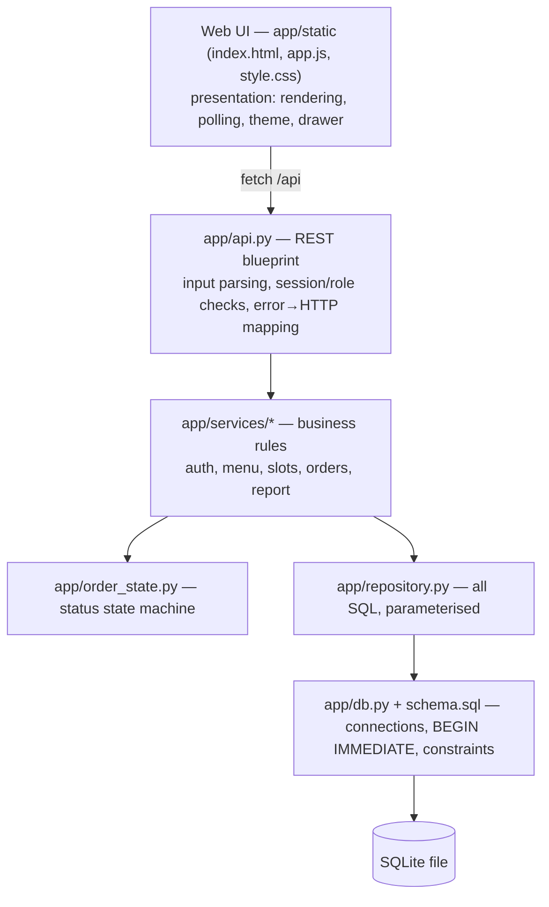

# Architecture and Design

**Project:** ReadySteady — Campus Canteen Pre-Ordering System
**Version:** 1.0 · **Date:** 18 November 2026
Companion documents: `SRS.md` (requirements), `PROJECT-PLAN.md`, `MAINTENANCE.md`, `uml/`.

## 1. Architectural style

A **layered (n-tier) monolith** with a repository pattern, deployed as a single Flask process
serving both a JSON REST API and a static single-page frontend over one SQLite file.

**Dependency rule:** each layer calls only the layer below. Routes contain no business rules and
no SQL; services contain no HTTP and no SQL strings; the repository contains no policy. This is
what makes the 60 unit tests possible without a web server.

## 2. Module responsibilities

| Module | Responsibility | Explicitly NOT responsible for |
|---|---|---|
| `app/__init__.py` | Application factory, config (env + injectable clock), DB bootstrap, teardown | Request handling |
| `app/api.py` | URL routing, JSON body parsing, `requires(*roles)` RBAC, `AppError`→HTTP | Business decisions, SQL |
| `app/services/auth_service.py` | Registration validation, hashing, login, public user projection | Sessions, HTTP codes |
| `app/services/menu_service.py` | Item CRUD validation, canteen scoping, slot config, wallet top-up | SQL, HTTP |
| `app/services/slot_service.py` | Slot generation, availability, lead-time/alignment validation | Booking writes |
| `app/services/order_service.py` | Cart normalisation, atomic placement, cancel/reject refunds, status moves, queue | SQL strings, HTTP |
| `app/services/report_service.py` | Daily aggregation (revenue excludes cancelled/rejected) | Writes |
| `app/order_state.py` | Status enum, transition table, terminal/holds-slot/staff-target sets | Persistence |
| `app/repository.py` | Every SQL statement, parameterised; row→dict projection | Validation, policy |
| `app/db.py` | Connections (autocommit + explicit `BEGIN IMMEDIATE`), per-request lifecycle, schema init | Queries |
| `app/schema.sql` | Tables, CHECK/FK constraints, indexes | Behaviour |
| `app/static/*` | Role views, cart, polling, theme, drawer, toasts, escaping | Trusting client-side checks |

## 3. Key design decisions and justification

| # | Decision | Why | Alternatives considered & rejected |
|---|---|---|---|
| 1 | Layered monolith + repository pattern | Course-scale team; one deployable; single SQL choke point simplifies security review (NFR-03) and testing | Microservices (ops overhead), ORM (hides the SQL the course wants visible) |
| 2 | SQLite with `BEGIN IMMEDIATE` transactions | Single-node campus scope; the write lock is taken *before* reads of stock/capacity/wallet, so check-then-act is atomic (NFR-02, proven by ST-03/04) | PostgreSQL `SELECT … FOR UPDATE` (needs a DB server); default deferred transactions (read-then-write race) |
| 3 | Money as integer paise | Exact arithmetic; no float rounding in totals, refunds or reports (NFR-06) | Float rupees (rounding drift), Decimal (heavier, unnecessary at this scale) |
| 4 | Explicit transition table state machine | One readable source of truth for the order life cycle; matches the UML state diagram; illegal moves fail closed | Scattered `if status == …` checks (drift, untestable) |
| 5 | Clock injected via `app.config["CLOCK"]` | Slot/lead-time logic is time-dependent; tests freeze 19 Nov 2026 11:00 for determinism | `freezegun` dependency; sleeping in tests (slow, flaky) |
| 6 | Server-side session cookie auth | Simple revocation (logout clears session), HttpOnly+SameSite=Lax mitigates XSS/CSRF theft; RBAC decorator centralises FR-02 | JWT (revocation and storage complexity without benefit here) |
| 7 | 5-second polling for live views | Meets "status visible within 5 s" with zero extra infrastructure; trivially debuggable | WebSocket/SSE (connection lifecycle, proxies, more code for one demo queue) |
| 8 | Vanilla JS SPA, no build step | Zero toolchain for a course prototype; every server string escaped through one `esc()` helper (NFR-03) | React/Vue (build pipeline, bundle size, learning cost mid-semester) |
| 9 | Order lines snapshot name + unit price | History and reports stay correct after menu edits/price changes (NFR-06) | Joining live menu rows (history mutates retroactively) |
| 10 | Pickup token: 4 chars, confusable-free alphabet, unique among open orders | Readable aloud at a busy counter; collision-checked inside the write transaction | Sequential numbers (guessable, long), UUIDs (unreadable) |
| 11 | `AppError` taxonomy → stable codes + HTTP status | Clients branch on `error` codes (`slot_full`, `invalid_token`, …), not on prose; one error handler | Ad-hoc `abort()` calls (inconsistent payloads) |
| 12 | Audit ledgers: `order_events`, `wallet_transactions` | Every status change and money movement is reconstructable for disputes and maintenance (NFR-05) | Logging to stdout only (lost on restart, unqueryable) |
| 13 | Env-var config, legacy `READYTEADY_` prefix kept after the ReadySteady rename | Existing deployments/scripts keep working; rename is branding-only, contracts unchanged | Renaming vars (breaks every existing instance for no functional gain) |

## 4. Data model

Seven tables (`app/schema.sql`): `users`, `canteens`, `menu_items`, `orders`, `order_items`,
`order_events`, `wallet_transactions`.

- `users.wallet_paise ≥ 0` CHECK prevents overdraft at the storage layer as a second line of defence.
- `orders.slot_start` is text `YYYY-MM-DDTHH:MM`; day-prefix `LIKE` queries + the composite index
  `(canteen_id, slot_start, status)` serve queue, capacity and report reads.
- `order_items` snapshots `name`/`unit_price_paise`; `order_events` records from/to/actor/time;
  `wallet_transactions` records signed amounts with reason and optional order link.
- Foreign keys ON; slot bounds and role values enforced by CHECK constraints.

## 5. Critical flow: placing an order (concurrency-safe)

1. Route parses body, `requires("student")`, calls `order_service.place_order`.
2. Cart normalised (merge duplicates, limits) — pure validation, no writes.
3. `slot_service.validate_slot` — format, alignment, today, ≥10 min lead.
4. `BEGIN IMMEDIATE` acquires the write lock.
5. Re-check slot capacity, each item's availability/stock, wallet balance **inside** the lock.
6. Create order + token, decrement stock, insert snapshot lines, debit wallet, log event.
7. `COMMIT` (or `ROLLBACK` on any exception — nothing partial survives).

Because step 4 precedes step 5, two simultaneous orders for the last item serialise: the second
transaction sees the decremented stock and fails with `out_of_stock`. ST-03/ST-04 assert exactly
one winner among 8/10 racing threads.

## 6. Security design (NFR-03)

- **Injection:** every SQL value is a bound parameter; the only dynamic SQL fragments are
  placeholder lists and a whitelisted column set in `MenuRepo.update`.
- **Credentials:** PBKDF2-SHA256, 600k iterations, per-user salt; one generic login failure message.
- **Session:** signed cookie, HttpOnly, SameSite=Lax; secret from env in production.
- **Authorisation:** role decorator on every protected route + object-level ownership/canteen
  checks in services (defence in depth: UI hiding is never the only gate).
- **XSS:** single `esc()` escape helper applied to every server-provided string in `innerHTML`.
- **Abuse limits:** cart quantity caps, top-up range, slot capacity bounds, price bounds.

## 7. Frontend design

Single page, three role views rendered by plain functions; a global `state` object; one `api()`
fetch wrapper that surfaces stable error codes; `poll()` for live views. The UI revision adds a
glass navigation drawer (menu/cart/scheduled pickup/wallet/previous orders/login), a persisted
light/dark theme (cream+maroon / warm charcoal+maroon) with a Telegram-style circular reveal,
toast notifications (low balance, next available slot, status changes), an animated confirmation
tick on order placement, and reference photos per menu item mapped client-side by name so the
REST contract stays byte-identical.

## 8. Known limitations (feed into MAINTENANCE.md)

Single-process SQLite (no horizontal scale); polling latency ≤5 s; no rate limiting or HTTPS
termination in the dev server; no password reset or email verification; admin top-up stands in
for a real payment gateway; menu photos are a client-side name map (admin-created items fall back
to a placeholder). Each is a documented, deliberate scope decision, not an oversight.